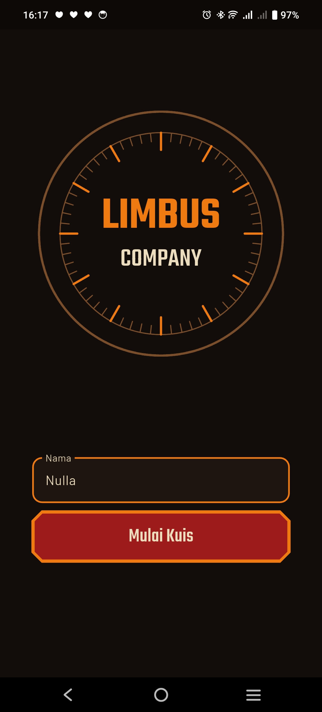
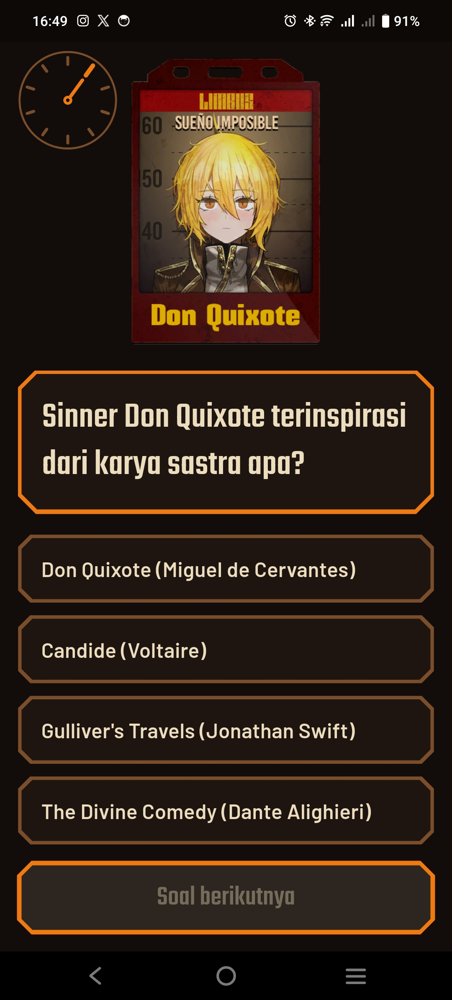
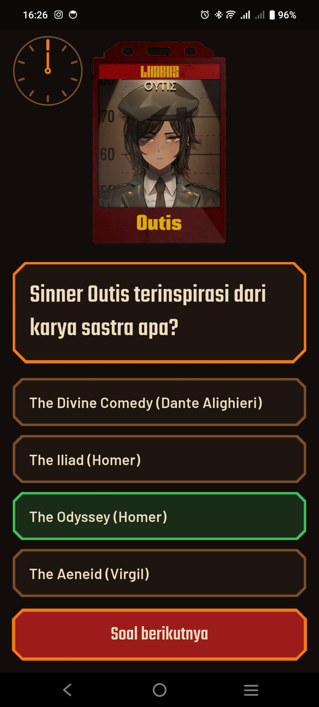
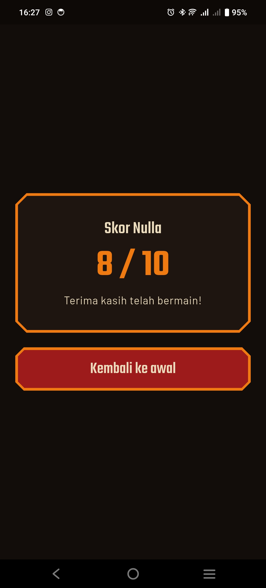
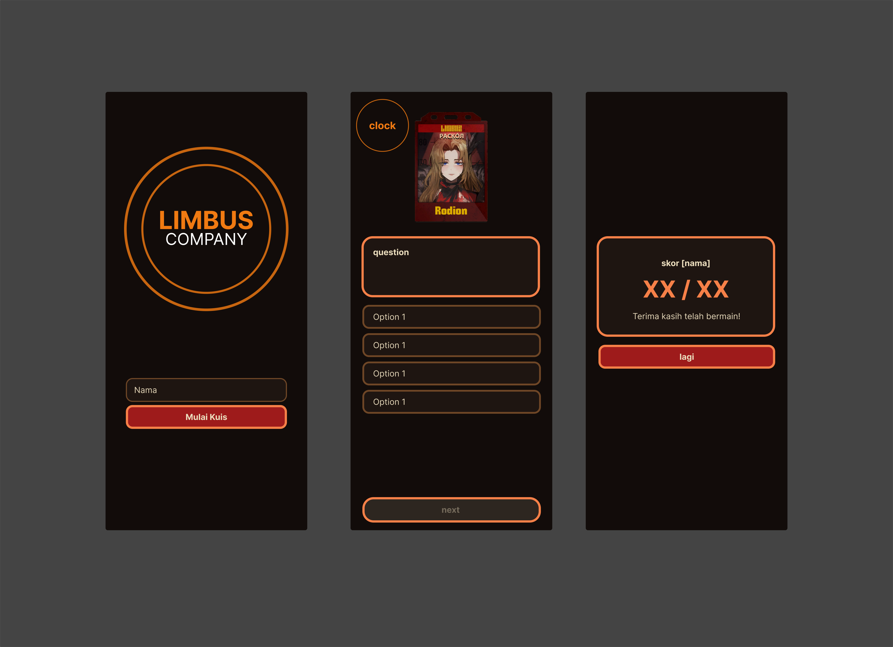

# Limbus Quiz

Aplikasi kuis pilihan ganda bertema **Limbus Company**, dibuat dengan Flutter untuk UTS Praktikum Pemrograman Mobile. Pemain memasukkan nama, menjawab serangkaian pertanyaan tentang asal karya sastra tiap Sinner, lalu melihat skor akhir atas namanya.

> Proyek fan-made untuk keperluan tugas kuliah, tidak berafiliasi dengan Project Moon.

## Identitas Mahasiswa

| | |
|---|---|
| **Nama** | Nasywa Zavira Lubis |
| **NIM** | 241401006 |
| **Lab** | Pemrograman Mobile (PM 5) |

## Informasi Aplikasi

**Nama aplikasi:** Limbus Quiz

**Deskripsi singkat:** Kuis pilihan ganda tentang asal karya sastra para Sinner di Limbus Company (misalnya Sinner mana yang terinspirasi dari *Faust*, *Moby-Dick*, atau *The Metamorphosis*). Tampilan mengikuti nuansa UI game: latar gelap, aksen oranye, panel bersudut terpotong, potret Sinner, dan jam sebagai penanda progres.

### Fitur

1. **Input nama pemain** dengan validasi (tidak boleh kosong, maksimal 20 karakter).
2. **Satu putaran 10 soal** yang diambil acak dari bank soal; urutan pilihan jawaban juga diacak setiap putaran.
3. **Bank soal lokal** di `assets/questions.json` (tanpa database), berisi soal "Sinner X terinspirasi dari karya sastra apa?" beserta pilihan, jawaban yang benar, dan path gambar potret.
4. **Potret Sinner** di atas setiap soal, diambil dari `assets/images/`.
5. **Umpan balik langsung**: pilihan benar berwarna hijau, pilihan salah berwarna merah, dan jawaban yang benar ditampilkan jika pemain salah.
6. **Jam progres animasi**: satu penanda per soal, jarum berputar ke soal yang sedang dikerjakan, dan penanda berubah warna sesuai hasil jawaban (hijau benar, merah salah).
7. **Layar hasil**: skor atas nama pemain, pesan penutup, dan tombol kembali ke awal. Kuis baru dimulai dengan soal yang diacak ulang.
8. **Lanjutkan kuis**: progres disimpan di state management, jadi tidak hilang saat pindah halaman atau layar dirotasi.
9. **Ukuran elemen dinamis**: ukuran huruf, jarak, sudut, dan garis tepi dihitung dari ukuran layar, dan halaman dapat di-scroll agar tidak overflow.

### Teknologi

- Flutter dan Dart
- [`provider`](https://pub.dev/packages/provider) untuk state management
- Font kustom Teko dan Barlow
- Gambar potret berformat WebP

## Struktur Proyek

```
assets/
├─ questions.json          # bank soal
├─ images/                 # potret Sinner (WebP)
└─ fonts/                  # file font Teko dan Barlow
docs/
├─ screenshots/            # screenshot tiap halaman
└─ ref.png                 # referensi mockup
lib/
├─ main.dart
├─ data/question_repository.dart   # memuat dan mengacak soal dari JSON
├─ models/question.dart            # model soal
├─ providers/quiz_provider.dart    # state: nama, soal, jawaban, skor
├─ screens/
│  ├─ home_screen.dart
│  ├─ quiz_screen.dart
│  └─ result_screen.dart
├─ theme/limbus_theme.dart         # warna dan ThemeData
└─ widgets/                        # komponen UI yang dipakai ulang
   ├─ clock_dial.dart
   ├─ quiz_clock.dart
   ├─ limbus_button.dart
   ├─ limbus_option_tile.dart
   ├─ limbus_panel.dart
   └─ sinner_portrait.dart
```

## Cara Menjalankan

Prasyarat: Flutter 3.27 atau lebih baru.

```bash
git clone https://github.com/NasywaZavira/limbus_quiz_pm5.git
cd limbus_quiz_pm5
flutter pub get
flutter run
```

Untuk mencoba tampilan web: `flutter run -d chrome`.

## Pemenuhan Kriteria

| Kriteria | Implementasi |
|---|---|
| StatelessWidget dan StatefulWidget | `HomeScreen` memakai `StatefulWidget` (controller kolom nama); layar lain dan widget komponen memakai `StatelessWidget`. |
| Minimal 2 halaman dan navigasi | Tiga halaman (awal, kuis, hasil) dengan `Navigator.push`, `pushReplacement`, dan `popUntil`. |
| Reusable widget di file terpisah | Folder `lib/widgets/`: panel, tombol, pilihan jawaban, potret Sinner, jam dekoratif, dan jam progres. |
| Aset gambar atau ikon | 12 potret Sinner (WebP) di `assets/images/`, ditampilkan di atas soal lewat widget `SinnerPortrait`. |
| Font kustom | Teko dan Barlow, dibundel di `assets/fonts/` dan dideklarasikan di `pubspec.yaml`. |
| Ukuran UI dinamis | Ukuran huruf, jarak, sudut, dan garis tepi dinyatakan sebagai kelipatan satu satuan yang dihitung dari `MediaQuery` (1 unit = 1% sisi terpendek layar). Halaman utama memakai `LayoutBuilder` dan dapat di-scroll. |
| State management | `Provider` (`QuizProvider`) menyimpan nama, soal, jawaban, dan skor di luar widget. |
| Tanpa database | Soal dibaca dari `assets/questions.json`. |
| GitHub | Riwayat commit per fitur di branch `main`. |

## Dokumentasi

### Credit Aset

| Aset | Digunakan untuk | Sumber | Lisensi |
|---|---|---|---|
| Teko | Judul dan angka | [Google Fonts](https://fonts.google.com/specimen/Teko) (Indian Type Foundry) | SIL Open Font License 1.1 |
| Barlow | Teks isi | [Google Fonts](https://fonts.google.com/specimen/Barlow) (Jeremy Tribby) | SIL Open Font License 1.1 |
| Potret Sinner (`assets/images/`) | Gambar di atas tiap soal | (https://limbuscompany.wiki.gg) | Hak cipta Project Moon; dipakai non-komersial untuk tugas kuliah |

Catatan:
- *Limbus Company*, nama para Sinner, potret karakter, dan tema terkait adalah milik **Project Moon**. Aplikasi ini hanya proyek penggemar untuk tugas kuliah.
- Judul karya sastra pada soal adalah milik penulis masing-masing dan hanya disebut sebagai referensi.
- Jam, panel, dan warna dibuat sendiri dengan kode Flutter, terinspirasi dari gaya UI game.

### Screenshot

| Halaman | Tampilan |
|---|---|
| Layar awal |  |
| Layar kuis (sebelum menjawab) |  |
| Layar kuis (setelah menjawab) |  |
| Layar hasil |  |

### Mockup / Prototype



[Link mockup di Figma](https://www.figma.com/design/NljHWIHWb3QzZQDVhtU84q/Projects?node-id=1584-32&t=zDHFakndzYlkoaPw-1)

